<div align="center">


<h3>
  <a href="https://aarogya-vayu.vercel.app"><b>▶&nbsp; Try the live app</b></a>
  &nbsp;·&nbsp;
  <a href="https://youtu.be/D8w2qviTuW4">🎬&nbsp; Watch the video</a>
  &nbsp;·&nbsp;
  <a href="#-try-it-in-60-seconds">⏱️&nbsp; 60-second tour</a>
  &nbsp;·&nbsp;
  <a href="#-how-it-works">🧭&nbsp; How it works</a>
</h3>

[](https://github.com/Ritesh-Root/aarogya-vayu/actions/workflows/tests.yml)
[](https://ai.google.dev/)
[](https://open-meteo.com/en/docs/air-quality-api)
[](https://fastapi.tiangolo.com/)
[](https://aarogya-vayu.vercel.app)

**🏆 Top 10 finalist · Google *Build with AI: Code for Communities 2.0* · Track 3: Smart Health & Supply Chain Resilience**

</div>

---

## 🩺 The problem, in one example

When winter smog settles over the Indo-Gangetic plain, breathing problems surge within days. Clinics order medicine once a month, so nobody sees the surge coming, and no system lets one clinic help another.

<table>
<tr>
<td width="50%" valign="top">

### 🔴 PHC Kakori
**15** salbutamol respules left<br>
Uses **32.4 a day** during smog (×1.62)<br>
➜ **0.5 days** until it runs out

</td>
<td width="50%" valign="top">

### 🟢 CHC Nawabganj, 30.2 km away
Has **spare** salbutamol<br>
Its batch **expires in ~70 days**<br>
➜ will be **thrown away** if nobody uses it

</td>
</tr>
</table>

**Aarogya-Vāyu connects the two.** It reads the air, hears the clinic's report, finds the clinic that can spare stock, and asks the district doctor to approve the transfer. Here: **270 units, 30.2 km, Kakori goes from 0.5 to 8.8 days of cover.**

<sub>Figures are from the app's Lucknow smog scenario. Inventory is sample data; air quality and weather are live.</sub>

---

## 🎬 See it work

<div align="center">
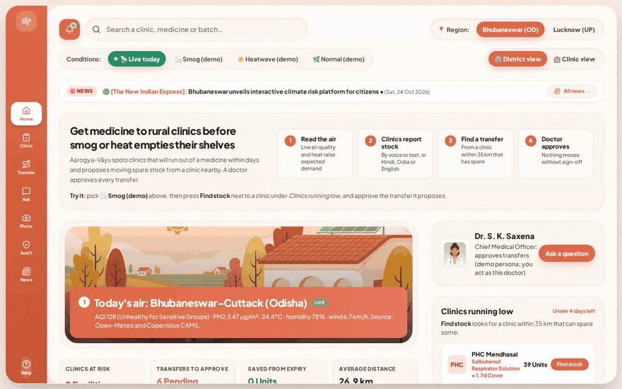
<br>
<sub>Smog demo → <b>Find stock</b> → five agents → Gemini calls the transfer solver → the doctor approves → dispatch note. (Agent step shown at 1.8× speed.)</sub>
</div>

---

## 🧭 How it works

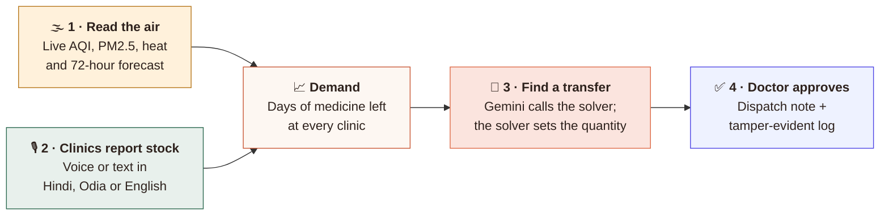

| | Step | What happens | Where in the code |
|:-:|---|---|---|
| 🌫️ | **Read the air** | Live weather and air quality (Open-Meteo + Copernicus CAMS) set a demand multiplier for each medicine: smog raises breathing medicines, heat raises ORS and fever medicine. | `app/telemetry_service.py`, `app/surge_engine.py` |
| 🎙️ | **Clinics report stock** | Staff speak or type a short update. Gemini transcribes it and picks out the clinic, medicine and count, matched to the state Essential Drug List. If no number is said, it asks instead of guessing. | `app/speech_service.py`, `app/voice_service.py` |
| 📈 | **Demand** | Days of cover = stock ÷ (normal daily use × multiplier), plus a 7-day stockout probability. Anything under 4 days is flagged. | `app/surge_engine.py` |
| 🚚 | **Find a transfer** | Gemini decides to call `calculate_optimal_transfer`; a deterministic allocator picks the donor and the quantity under hard rules. | `app/agent_orchestrator.py`, `app/optimizer.py` |
| ✅ | **Doctor approves** | Nothing moves without the CMO's sign-off. Approval issues a dispatch note and is written to a SHA-256 hash-chained audit log. | `app/main.py`, `app/audit_ledger.py` |

---

## ⏱️ Try it in 60 seconds

Open **[aarogya-vayu.vercel.app](https://aarogya-vayu.vercel.app)** and:

- [ ] Read the strip at the top: four numbered steps. Click any step to jump to it.
- [ ] Under **Conditions**, pick **🌫️ Smog (demo)**. The banner and the clinic list change.
- [ ] Under **Clinics running low**, press **Find stock** on the first clinic. Watch the five agents light up.
- [ ] Press **Review and approve**, then **Approve & Reserve Stock**. A dispatch note appears.
- [ ] Press **Ask** in the side menu and ask *"Which clinics will run out first?"* Then press **Read aloud** to hear Gemini's voice.
- [ ] Press **Photo** and upload [`docs/samples/shelf_salbutamol.jpg`](docs/samples/shelf_salbutamol.jpg). Gemini counts the boxes and checks them against the register.
- [ ] Press **Audit**, then **Verify**. Every action is hash-chained.
- [ ] Press **Clinic** in the side menu, then **हिन्दी**. The clinic's own screen switches to Hindi.
- [ ] Your **Conditions** choice is yours alone: it is remembered in your browser and doesn't change what other visitors see.

---

## 📊 Does it help? A simulation

We replayed a climate surge on the app's 40 sample clinics, with and without Aarogya-Vāyu, using the app's own demand engine and transfer allocator (`scripts/simulate_impact.py`, 20 runs each, no store deliveries inside the window).

<div align="center">
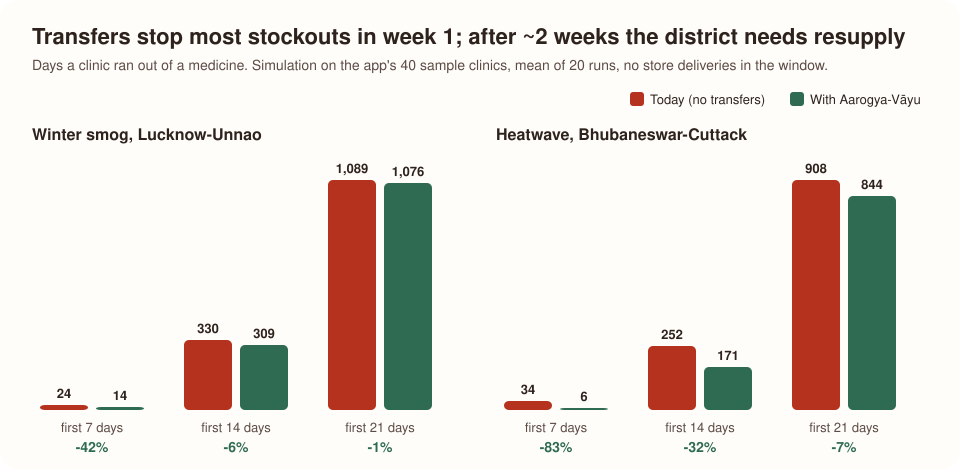
</div>

| Surge window | Smog, Lucknow-Unnao | Heatwave, Bhubaneswar-Cuttack |
|---|:-:|:-:|
| **First 7 days** | **−42%** clinic-days without the medicine, −32% doses missed | **−83%** clinic-days, −69% doses missed |
| First 14 days | −6% clinic-days, −5% doses | −32% clinic-days, −21% doses |
| First 21 days | −1% | −7% |

**What this says:** moving spare stock between nearby clinics prevents most stockouts in the first week of a surge. After about two weeks, the whole district is short (the sample data holds about 17–20 days of each medicine across all clinics), and no amount of redistribution helps; the district needs resupply. That's why the app also reports **unmet demand** (shortages no clinic within 35 km can cover) for escalation to the district store.

<sub>Sample inventory and the app's own multipliers, not field data. Assumptions are listed at the top of the script; results are in `docs/impact.json`.</sub>

---

## 🖼️ Screenshots

<table>
<tr>
<td width="50%">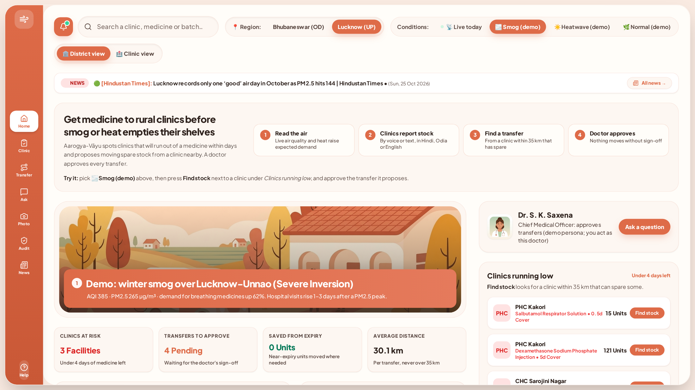<br><sub><b>Dashboard.</b> What the app does in four steps; today's air; clinics running low.</sub></td>
<td width="50%">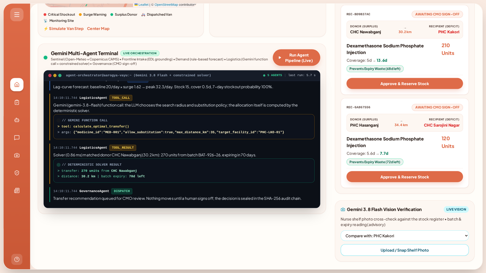<br><sub><b>Find a transfer.</b> Five agents, one proposal: 270 units, 30.2 km, 0.5 → 8.8 days.</sub></td>
</tr>
<tr>
<td>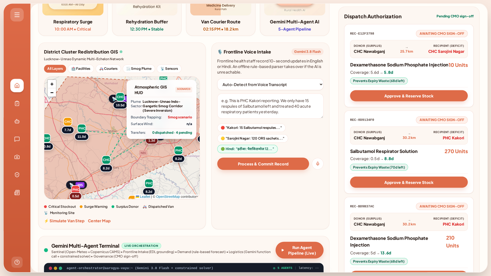<br><sub><b>Clinic map + voice report.</b> Red is running out, green has spare.</sub></td>
<td>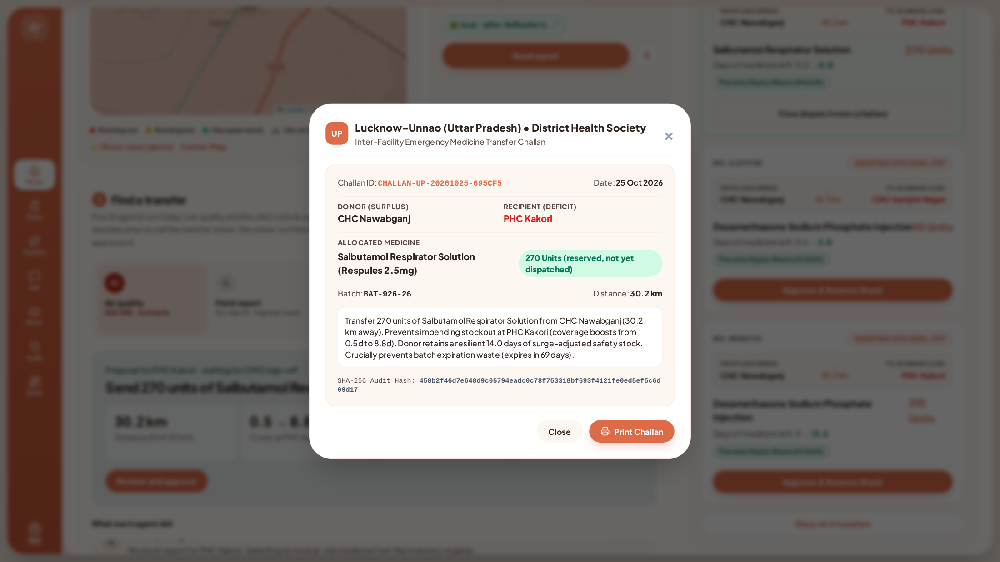<br><sub><b>Dispatch note (challan).</b> Issued only after the doctor approves.</sub></td>
</tr>
<tr>
<td>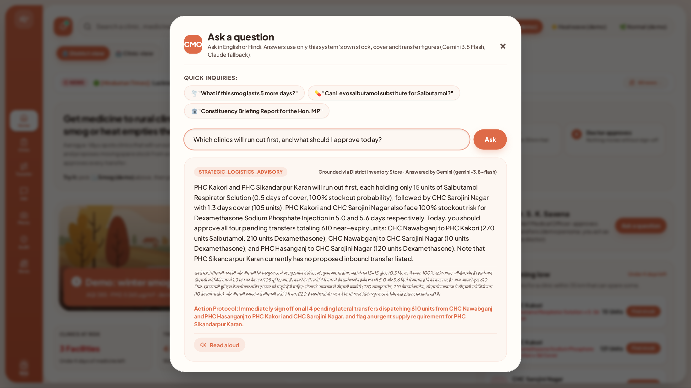<br><sub><b>Ask a question.</b> Gemini answers from the system's own figures, in English and Hindi.</sub></td>
<td>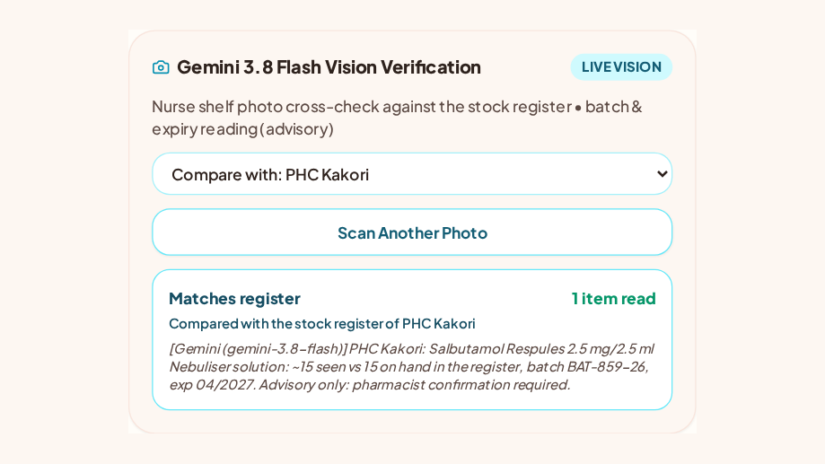<br><sub><b>Shelf photo check.</b> Gemini counted 15 boxes, read batch BAT-859-26 and matched the register.</sub></td>
</tr>
<tr>
<td>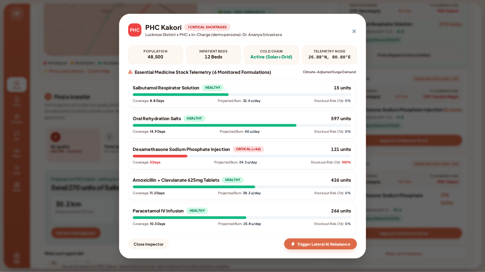<br><sub><b>Clinic detail.</b> Every medicine's cover and stockout risk at one clinic.</sub></td>
<td>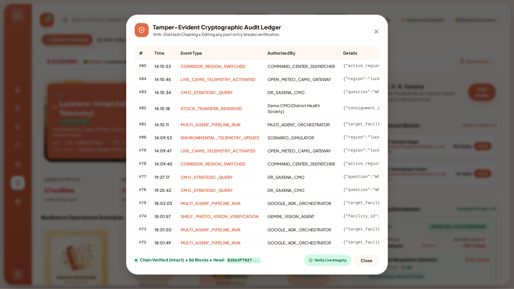<br><sub><b>Audit log.</b> Editing any past entry makes verification fail.</sub></td>
</tr>
</table>

---

## 🤖 What is AI and what is maths

> **A model never chooses a quantity of medicine.** Gemini does the language and perception work; deterministic code does the arithmetic, and a person approves.

| Job | Done by | Live? |
|---|---|:-:|
| Transcribe voice notes (English / Hindi / Odia) | Gemini 3.8 Flash (audio) | ✅ |
| Read a stock report → clinic, medicine, count | Gemini 3.8 Flash, Claude Haiku 5.5 fallback, then a rule-based parser that flags its guesses | ✅ |
| Decide to call the transfer tool | Gemini function calling (`calculate_optimal_transfer`) | ✅ |
| Choose donor and quantity | Deterministic greedy allocator (`app/optimizer.py`) | ✅ |
| Read a shelf photo | Gemini 3.8 Flash vision | ✅ |
| Answer the CMO's questions | Gemini 3.8 Flash, grounded in the system's own figures | ✅ |
| Read the answer aloud | Gemini text-to-speech (`gemini-3.8-flash-tts`) | ✅ |
| Air quality, weather, 72 h forecast | Open-Meteo + Copernicus CAMS | ✅ |
| Demand forecast | Transparent rules (multipliers), not a trained model | ✅ |
| Clinic inventories, facility figures | Sample data (no public stock API exists) | 🧪 |

`GET /api/system/capabilities` returns this map at runtime, including which AI providers are configured.

<details>
<summary><b>🔍 Under the hood: one run, step by step</b></summary>

<br>

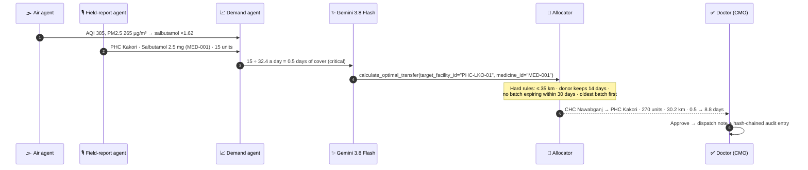

</details>

<details>
<summary><b>🧮 Transfer rules (the allocator)</b></summary>

<br>

The allocator in `app/optimizer.py` is a deterministic greedy algorithm, not a model:

1. **Recipients, most critical first:** clinics sorted by days of cover.
2. **Eligible donors:** within **35 km** (straight line), at least **16 days** of surge-adjusted cover, and at least one batch that is **30+ days** from expiry.
3. **Donor order:** stock at risk of expiring first, then the soonest expiry, then the most cover.
4. **Quantity:** enough to bring the recipient to **14 days** of cover, never taking the donor below **14 days** of its own surge-adjusted use, in packs of 10.
5. **Batch:** first expiry, first out (FEFO).
6. **Escalation:** if no clinic within 35 km can help, the shortfall is escalated with the reasons each candidate was rejected.

When a transfer is approved, the donor's and the recipient's stock change by exactly the same amount; a stale or double approval is rejected with `409 Conflict`.

</details>

<details>
<summary><b>🌡️ How weather changes demand for each medicine</b></summary>

<br>

Every medicine is checked in every scenario; the weather decides how much faster each one is used.

| Medicine | Driven by | Smog (AQI 385) | Heatwave | Normal |
|---|---|:-:|:-:|:-:|
| Salbutamol (nebuliser) | Air quality | ×1.62 | ×1.0 | ×1.0 |
| Dexamethasone (injection) | Air quality | ×1.62 | ×1.0 | ×1.0 |
| Cetirizine | Smog and dust | ×1.62 | ×1.0 | ×1.0 |
| Amoxicillin + clavulanate | Chest infections after smog | ×1.53 | ×1.0 | ×1.0 |
| Paracetamol IV | Heat or infection | ×1.43 | ×1.60 | ×1.0 |
| ORS | Heat | ×1.0 | ×1.75+ | ×1.0 |

Thresholds are in `app/surge_engine.py`. The engine plans against the worse of today and the 72-hour forecast.

**What the evidence says, and where our numbers stand:**

| Evidence | Finding | Our rule |
|---|---|---|
| Yadav et al. 2021, *Environ Sci Pollut Res* ([doi](https://doi.org/10.1007/s11356-021-13600-7)), AIIMS Delhi | Children's respiratory ER visits **+21%** on moderate and **+29%** on high-pollution days | Our top AQI bands (×1.62, ×1.90) are **higher** than this |
| Zheng et al. 2015, *PLoS ONE* ([doi](https://doi.org/10.1371/journal.pone.0138146)), meta-analysis of 37 studies | Asthma ER visits and admissions **+2.3% per 10 µg/m³ PM2.5**; effects strongest at lag ≥ 2 days | Supports the direction and the 1–3 day lag |
| Kawano et al. 2026, *npj Clean Air* ([link](https://www.nature.com/articles/s44407-026-00053-w)), 1.1 M ambulance dispatches in India | **+3.8%** same-day pediatric dispatches per 10 µg/m³, still raised over 7 days | Supports a same-day rise that lasts about a week |
| Azhar et al. 2014, *PLoS ONE* ([doi](https://doi.org/10.1371/journal.pone.0091831)), Ahmedabad 2010 heatwave | Deaths **×1.76–2.12** in the hottest week (46.8 °C) | Our ×2.10 above 44 °C matches deaths, not ORS demand; no study measures ORS demand directly |

**In short:** the direction and timing are supported; the top smog multipliers are set above what Delhi ER data shows, and the heat multipliers are based on mortality, not medicine use. They are planning assumptions (erring toward warning early), to be calibrated against real consumption in a pilot. The 85% / 80% / 70% shares for amoxicillin and paracetamol are design assumptions with no direct source.

</details>

<details>
<summary><b>🔌 API reference</b></summary>

<br>

| Method | Endpoint | What it does |
|---|---|---|
| `GET` | `/api/environmental?region=` | Live (or scenario) air quality, weather and surge multipliers |
| `GET` | `/api/risks?region=` | Days of cover and stockout risk for every clinic and medicine |
| `GET` | `/api/recommendations?region=` | Proposed transfers waiting for approval |
| `POST` | `/api/agents/run-resilience-pipeline` | Run the five agents for one clinic (Gemini function calling + allocator) |
| `POST` | `/api/voice-intake/transcribe` | Gemini speech-to-text for a 16 kHz WAV voice note |
| `POST` | `/api/voice-intake` | Parse a stock report into a draft update |
| `POST` | `/api/approve-transfer` | CMO approval: reserves stock, issues the dispatch note |
| `POST` | `/api/cmo/chat` | Ask a question; answered from the system's own figures |
| `POST` | `/api/cmo/speak` | Read an answer aloud (Gemini text-to-speech, returns WAV) |
| `POST` | `/api/vision/verify-shelf-photo` | Count stock in a shelf photo and compare with the register |
| `GET` | `/api/audit-log/verify` | Walk the SHA-256 hash chain from the first entry |
| `GET` | `/api/system/capabilities` | What is live, what is sample data, which AI providers are set |

Clinic workflow (stock actions, dispatch, receipt, reconciliation) lives under `/api/clinic/{facility_id}/…` and `/api/transfer/…`.

</details>

<details>
<summary><b>💻 Run it locally</b></summary>

<br>

```bash
git clone https://github.com/Ritesh-Root/aarogya-vayu.git
cd aarogya-vayu
cp .env.example .env          # add GEMINI_API_KEY (free at https://aistudio.google.com/)

uv sync                       # or: python -m venv .venv && . .venv/bin/activate && pip install -r requirements.txt
uv run pytest -q              # 53 tests; no API keys needed (AI calls fall back offline)
uv run uvicorn app.main:app --port 8000
```

Open <http://localhost:8000>. Without a Gemini key the app still runs: voice reports use the rule-based parser and the CMO answers come from a template.

> Tests write to `data/*.json`. Run `git checkout -- data` afterwards to restore the demo dataset, and don't run two test sessions at once.

</details>

<details>
<summary><b>🗂️ Project structure</b></summary>

<br>

```
app/
  main.py                FastAPI routes, rate limits, approval flow
  agent_orchestrator.py  The five-agent pipeline and Gemini function calling
  optimizer.py           Deterministic transfer allocator (35 km, 14-day reserve, FEFO)
  surge_engine.py        Weather → demand multipliers → days of cover
  telemetry_service.py   Open-Meteo + Copernicus CAMS live feed
  speech_service.py      Gemini speech-to-text and text-to-speech
  voice_service.py       Stock-report parsing and drug-list matching
  vision_service.py      Gemini shelf-photo reading
  llm.py                 Gemini first, Claude Haiku fallback, time budgets
  audit_ledger.py        SHA-256 hash-chained audit log
static/                  Single-page app (Tailwind, Leaflet, Lucide)
data/                    Sample facilities, inventory and medicines (two regions)
tests/                   53 tests: allocator invariants, API, scenarios, clinic workflow
scripts/simulate_impact.py  Before/after simulation (writes docs/impact.svg and docs/impact.json)
```

</details>

---

## 💰 What it costs to run

A rough estimate for one district of 20 clinics, at Google's published Gemini API prices (checked 25 Oct 2026):

| Use per month | Assumed size | Cost |
|---|---|--:|
| 600 voice reports (transcribe + read) | ~20 s audio, then ~2k tokens in, ~0.3k out | ~$2.10 |
| 600 transfer checks (Gemini tool call) | ~3.5k tokens in, ~0.4k out | ~$2.50 |
| 300 CMO questions | ~6k tokens in, ~1.5k out (two languages) | ~$3.00 |
| 300 read-alouds (Gemini text-to-speech) | ~30 s audio each (25 tokens/s) | ~$2.00 |
| 80 shelf-photo checks | one image, short answer | ~$0.20 |
| **Total** | | **≈ $10 a month (under ₹1,000)** |

<sub>gemini-3.8-flash: $0.75 / 1M input, $3.75 / 1M output; gemini-3.8-flash-tts: $9 / 1M audio output ([pricing page](https://ai.google.dev/gemini-api/docs/pricing)). Google has announced these 3.8 prices double from 1 Jan 2027 (≈ $20 a month). Token sizes are our estimates, not measured; Gemini's thinking tokens are billed as output and could raise the total. Hosting runs on Vercel's free tier; a pilot would add a small database for durable storage.</sub>

---

## 🛡️ Safety and privacy

- **A person approves every transfer.** The AI proposes; the district CMO decides.
- **No patient data.** Only facility stock counts and batch codes (DPDP Act 2023).
- **Tamper-evident log.** Every report, approval and dispatch is SHA-256 hash-chained; editing a past entry breaks verification. Entries are not yet digitally signed, so the log proves tampering, not authorship.
- **Overlay, not a replacement.** Designed to read from e-Aushadhi / DVDMS exports and send proposals back, with no new hardware.

## 🗺️ Roadmap

| Next | Why |
|---|---|
| Pilot on one district's real e-Aushadhi export (read-only) | Replace sample inventory with real stock |
| Outbreak and flood scenarios (dengue, diarrhoea) | Cover surges that aren't caused by air or heat |
| Road distance and 108/102 ambulance return trips | More realistic transport |
| Learned demand forecast | Once a pilot provides real consumption history |
| Offline voice and SMS alerts | Clinics with poor connectivity |

---

<div align="center">

Built by **Ritesh Kumar Mahato** for Google's *Build with AI: Code for Communities 2.0*

<sub>Air quality: <a href="https://open-meteo.com/">Open-Meteo</a> and <a href="https://atmosphere.copernicus.eu/">Copernicus CAMS</a> · Map: <a href="https://leafletjs.com/">Leaflet</a> and © OpenStreetMap contributors</sub>

</div>
